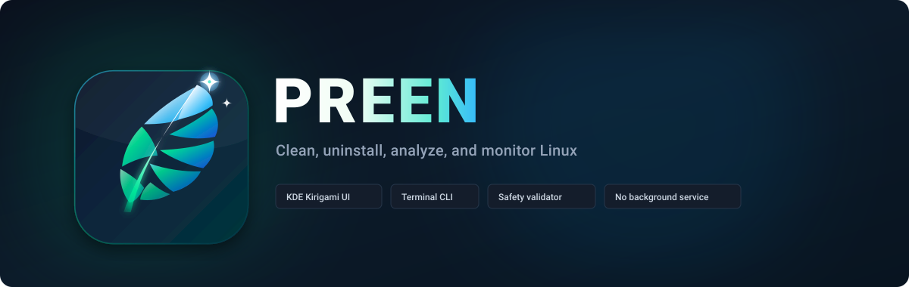
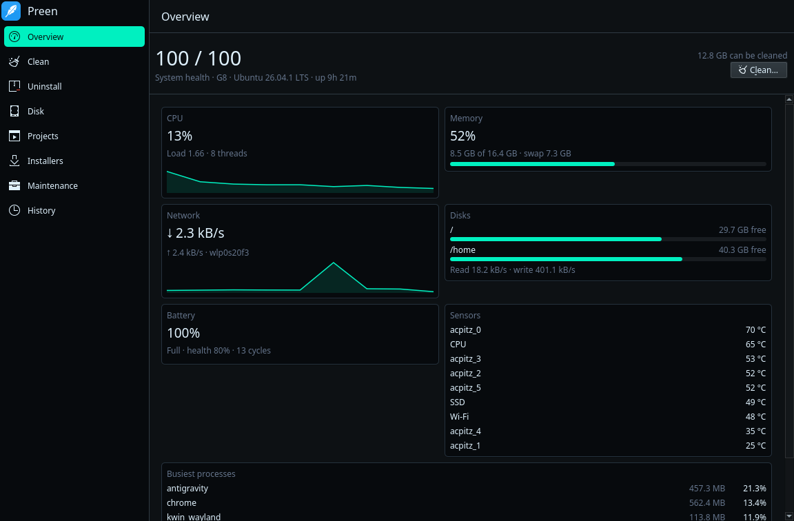
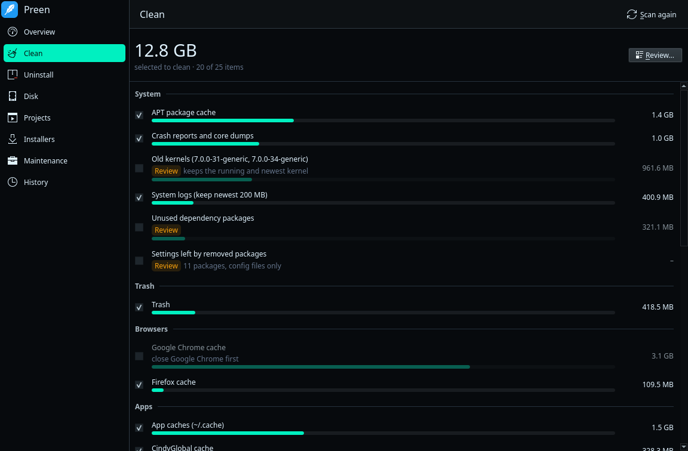
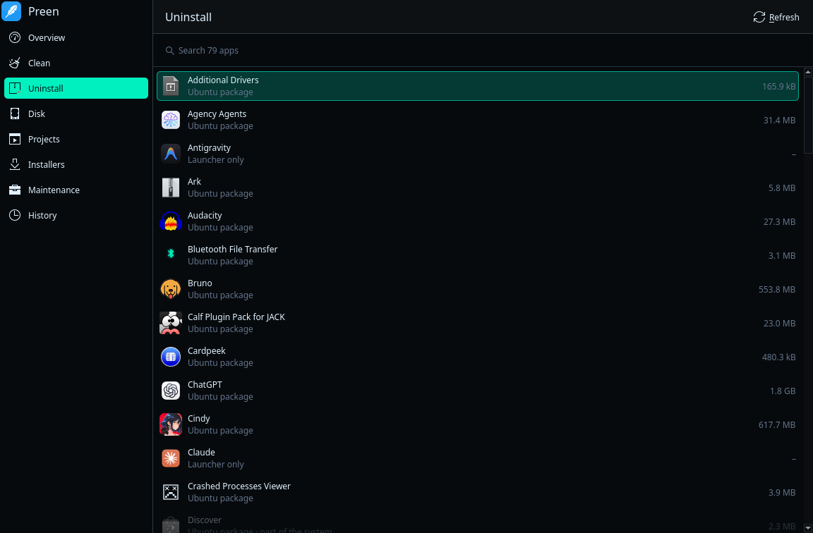
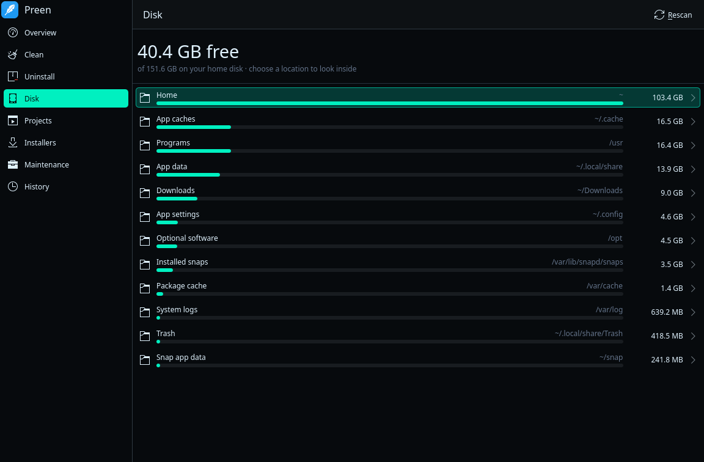
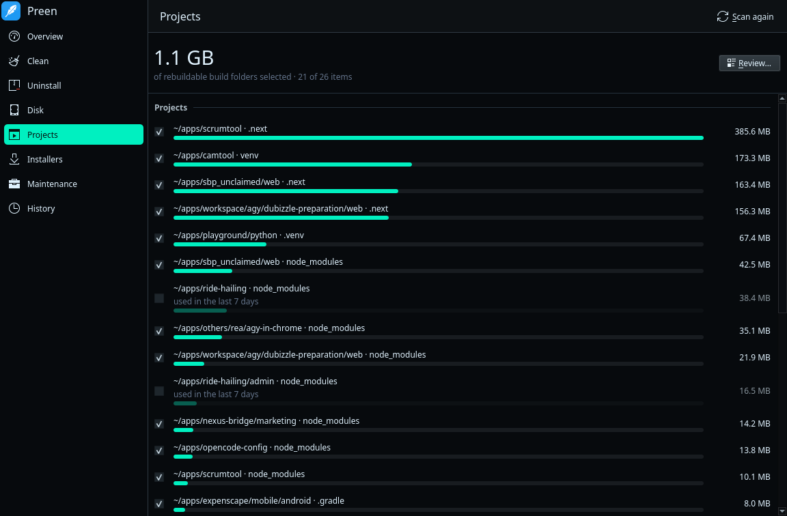
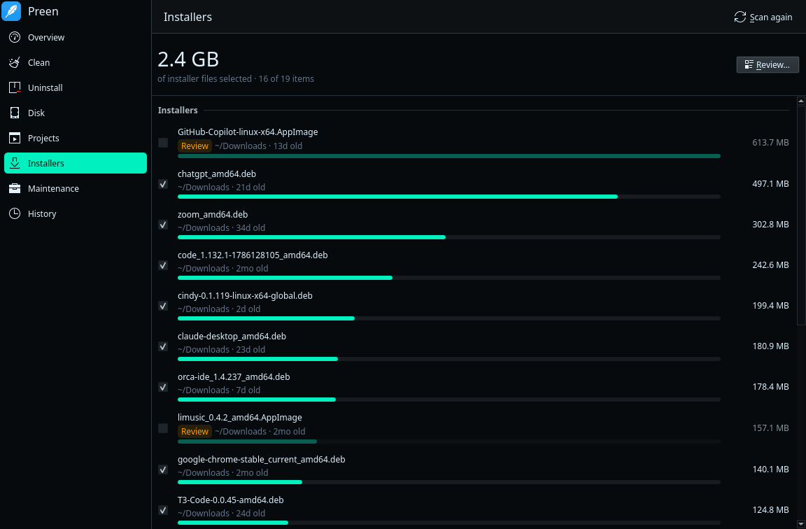
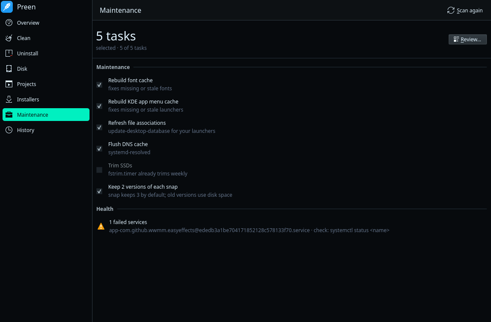
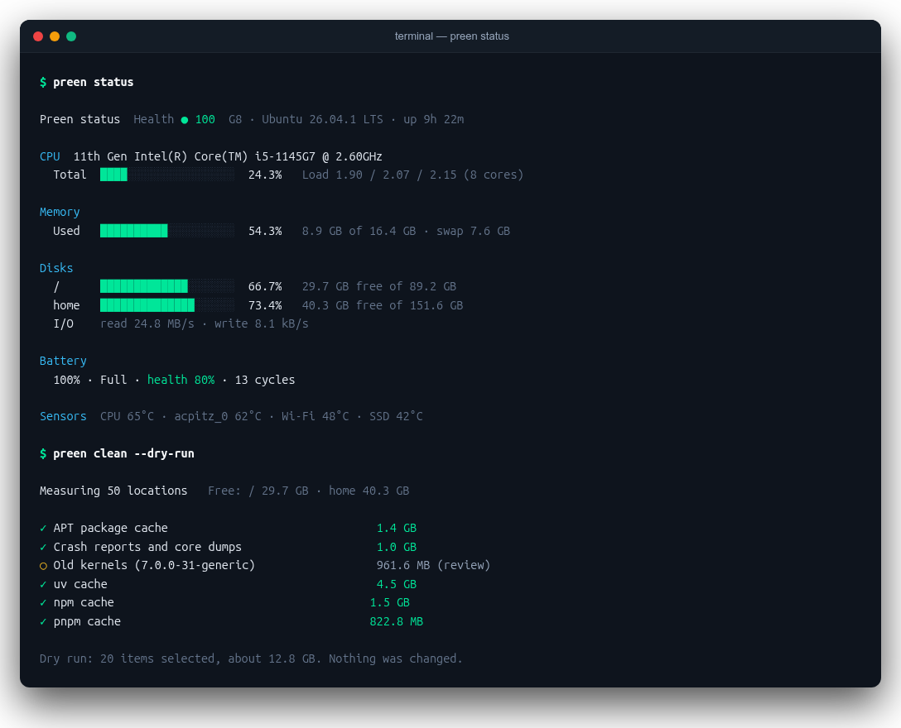

<div align="center">
  
</div>

<br/>

<div align="center">
  <a href="https://www.patreon.com/c/youxufkhan" target="_blank" rel="noopener noreferrer">
    
  </a>
  <a href="https://youxufkhan.github.io/preen/" target="_blank" rel="noopener noreferrer">
    
  </a>
  <a href="https://github.com/youxufkhan/preen/releases/latest" target="_blank" rel="noopener noreferrer">
    
  </a>
</div>

<br/>

Clean, uninstall, analyze, and monitor Linux from one application. Preen is built for Ubuntu and Kubuntu and inspired by [Mole](https://github.com/tw93/mole) for macOS.

- **Clean**: removes caches, logs, old snap versions, crash dumps, old kernels, browser and Electron app caches, and developer caches (uv, pnpm, npm, Bun, pip, Gradle, Cargo, Go).
- **Uninstall**: removes apt, snap, Flatpak, and AppImage applications together with residual files. Configuration files remain unless specifically selected. Sort by name, size, least used or recently installed.
- **Disk**: inspects disk usage folder by folder and moves items to the Trash.
- **Projects**: removes rebuildable `node_modules`, `target`, `build`, `.venv`, and similar build directories from the folders you choose (**Folders…** in the app, or `preen purge --add-path`).
- **Installers**: cleans leftover `.deb`, `.rpm`, `.run`, `.AppImage`, and `.iso` files from Downloads and Desktop.
- **Maintenance**: rebuilds font and application menu caches, flushes DNS, configures snap retention, and checks systemd service health.
- **Overview**: reports CPU load, memory distribution, disk throughput, network traffic, battery health, thermal sensors, and active processes.

Every removal is presented for review before execution. Nothing runs in the background.

## Interface and screenshots

| Overview & Telemetry | Clean Scan |
| :---: | :---: |
|  |  |
| CPU, memory, disk, network, and thermal telemetry | Reclaimable caches, logs, old kernels, and app leftovers |

| Application Uninstaller | Disk Space Explorer |
| :---: | :---: |
|  |  |
| Removes apt, snap, Flatpak, and AppImage packages | Hierarchical folder sizes with Trash support |

| Project Build Folders | Downloaded Installers |
| :---: | :---: |
|  |  |
| Cleans rebuildable `.next`, `.venv`, and `node_modules` folders | Finds leftover `.deb`, `.rpm`, and `.AppImage` packages |

| System Maintenance | Command Line Interface |
| :---: | :---: |
|  |  |
| Cache rebuilds, DNS flushes, and service diagnostics | Terminal dashboard with human-readable and `--json` outputs |

## How Preen compares

✅ yes · ◐ partly · ❌ no · – not applicable

| | Preen | BleachBit | btop | CCleaner | Mole |
|---|:-:|:-:|:-:|:-:|:-:|
| **Platform and interface** | | | | | |
| Runs on Linux | ✅ | ✅ | ✅ | ❌ Windows, macOS, Android | ❌ macOS (Windows beta) |
| Desktop app | ✅ KDE (Kirigami) | ✅ GTK | ❌ terminal | ✅ | ◐ separate paid Mac app |
| Command line with JSON output | ✅ | ◐ no JSON | ❌ | ◐ a few switches | ✅ |
| Free and open source | ✅ GPL-3 | ✅ GPL-3 | ✅ Apache-2.0 | ❌ freemium | ✅ GPL-3 (CLI) |
| **Cleaning** | | | | | |
| App caches, logs, temp files, Trash | ✅ | ✅ | ❌ | ✅ | ✅ |
| Browser caches | ✅ | ✅ | ❌ | ✅ | ✅ |
| Browser privacy data (cookies, history, passwords) | ❌ | ✅ | ❌ | ✅ | ❌ |
| Developer caches (npm, pnpm, uv, pip, Gradle, Cargo, Go) | ✅ | ❌ | ❌ | ❌ | ✅ |
| Package manager leftovers | ✅ apt, snaps, old kernels | ◐ apt, snaps; no kernels | ❌ | – | ✅ Homebrew |
| Project build folders (`node_modules`, `target`, `.venv`) | ✅ | ❌ | ❌ | ❌ | ✅ |
| Downloaded installer files | ✅ | ❌ | ❌ | ❌ | ✅ |
| Preview before deleting | ✅ | ✅ | – | ✅ | ✅ |
| Shred files, wipe free space | ❌ | ✅ | ❌ | ✅ | ❌ |
| **Apps** | | | | | |
| Uninstall apps with their leftovers | ✅ apt, snap, Flatpak, AppImage | ❌ | ❌ | ◐ runs the app's own uninstaller | ✅ |
| Startup apps manager | ❌ | ❌ | ❌ | ✅ | ❌ |
| Software updater | ❌ | ❌ | ❌ | ✅ paid | ❌ |
| **Disk and system** | | | | | |
| Disk usage explorer | ✅ | ❌ | ❌ | ✅ | ✅ |
| Duplicate file finder | ❌ | ❌ | ❌ | ✅ | ❌ |
| Live CPU, memory, disk and network | ✅ | ❌ | ✅ | ❌ | ✅ |
| Process list and control | ◐ busiest processes, no kill | ❌ | ✅ tree view, signals | ❌ | ◐ busiest processes |
| GPU stats | ❌ | ❌ | ✅ | ❌ | ✅ |
| Temperatures and battery health | ✅ | ❌ | ✅ | ❌ | ✅ |
| Maintenance (DNS, font and menu caches, SSD trim) | ✅ | ❌ | ❌ | ◐ Windows registry | ✅ |

The CCleaner column is the Windows version. The Mole column is the free command-line tool. Checked November 2026.

Preen does not yet do privacy cleaning, secure wiping, startup apps, duplicate files, process control or GPU stats. For now, use BleachBit for privacy cleaning and wiping, and btop for process control.

## Install

One-line installer (Ubuntu, Debian, Kubuntu, Arch, Fedora):

```bash
curl -fsSL https://youxufkhan.github.io/preen/install.sh | sh
```

Or install the package manually on Ubuntu or Kubuntu:

```bash
wget https://github.com/youxufkhan/preen/releases/download/v0.1.2/preen_0.1.2_amd64.deb
sudo apt install ./preen_0.1.2_amd64.deb
```

On other distributions, use the command-line engine on its own (`preen-linux-amd64` on the [releases page](https://github.com/youxufkhan/preen/releases)) or build from source (see Build below).

Then open **Preen** from the app menu, or use the terminal:

```bash
preen clean --dry-run        # see what would be removed
preen clean                  # remove the selected items (asks first)
preen uninstall --list --sort used   # installed apps, least used first (or: size, installed)
preen uninstall apt:btop --dry-run
preen analyze ~              # what uses space in your home folder
preen status --watch         # live dashboard
preen purge --dry-run        # build folders in your projects
preen purge --add-path ~/code   # also search ~/code (see: --paths, --remove-path)
preen installer --dry-run    # installer files in Downloads
preen optimize               # maintenance and health checks
preen history                # what Preen removed
```

Every command that removes something accepts `--dry-run`, `--yes`, `--json`, `--all` (also select items marked review) and `--only <id>`.

## Safety

- Every delete goes through one check (`internal/safe`). It refuses system folders, top-level folders, your home folder, `~/.ssh`, `~/.gnupg`, keyrings, browser password and cookie files, and symlinks that lead into any of them. A fuzz test guards it.
- Preen never runs as root. System items go through `pkexec preen helper <action>`, which accepts only a fixed list of named actions and re-checks each one. Removing a package that would take a desktop metapackage or a system package with it is refused.
- Apps that are running are skipped: Chrome, Electron apps, Firefox and Gradle are detected through their lock files or processes.
- Uninstall leftovers and Disk deletions go to the Trash. Clean, Projects and Installers delete permanently, as Mole does.
- Sizes count only space that would really be freed. A cache whose files are hard-linked into projects (uv, pnpm, Bun) is not over-reported.
- Every removal is logged to `~/.local/state/preen/operations.log` (see `preen history`). `PREEN_NO_OPLOG=1` turns the log off.
- Never clean something: add its path, or an item id such as `apt-cache`, to `~/.config/preen/whitelist`. If that file can't be read, Preen stops.
- Choose project folders: list them, one per line, in `~/.config/preen/purge_paths`.

## Build

```bash
sudo apt install golang-go g++ qt6-base-dev qt6-declarative-dev
make            # build/preen (engine) and build/preen-gui (Kirigami GUI)
make test       # Go tests, including the delete-safety fuzz seeds
make deb        # build/preen_<version>_amd64.deb
```

Layout:

- `*.go`: the engine, using only the Go standard library. There is one file per command, plus `engine.go` (events, sizes, plan runner) and `helper.go` (root actions).
- `internal/safe`: the delete validator.
- `gui/`: about 100 lines of C++ that run `preen <cmd> --json` and pass each JSON line to QML, plus the Kirigami pages in `gui/qml`.
- `packaging/`: the desktop file, polkit policy and Debian control file.

`PREEN_PAGE=clean PREEN_SCREENSHOT=out.png QT_QPA_PLATFORM=offscreen build/preen-gui` renders a page to a PNG without opening a window.

## License

GPL-3.0. Preen is an independent project and is not affiliated with Mole.
